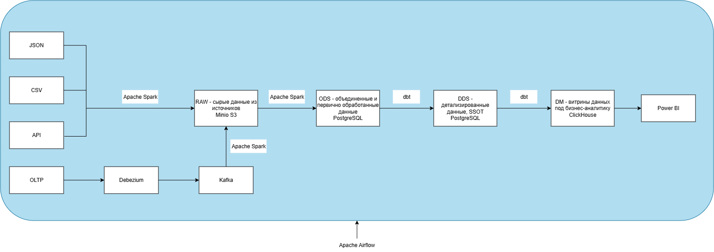

# 2. Архитектура.

Изобразим основную архитектуру системы, учитывая указанные источники и потребителя - аналитика.

	
	 
	Рис. 1. Архитектура системы.
	 

Опишем предоставленную схему.
* Источниками выступают **JSON, CSV, API** и **OLTP**. JSON, CSV и API с помощью **Apache Spark** попадают в слой RAW. Данные OLTP сначала с помощью механизма CDC попадают в Kafka, а затем доставляются в слой RAW. Это решение является заделом для будущего расширения системы - построения streaming pipeline.
* **Слой RAW** содержит сырые данные (AS-IS). Это необходимо для возможности повторно запустить pipeline, не обращаясь к источнику и не нагружая его. Также этот слой позволяет Data Scientist`ам проверять бизнес-гипотезы.
* **Слой ODS** содержит первично очищенные, актуальные данные. Здесь они типизируются и дедуплицируются. Этот слой необходим для оперативной аналитики.
* **Слой DDS** выполняет роль SSOT. Здесь данные лежат в нормализованном виде (3НФ). Они строго типизированы и валидированы. В данном слое хранится история изменений сущностей (SCD2). Он необходим для сохранения истории и получения достоверных данных.
* **Слой DM** - это слой витрин данных. Каждая собранная витрина нацелена на выполнение определенной задачи. Этот слой предоставляет аналитикам готовую агрегированную информацию для анализа.
* Для удобства аналитиков витрины данных отображаются в программах с графическим интерфейсом, в данном случае - Power BI.
