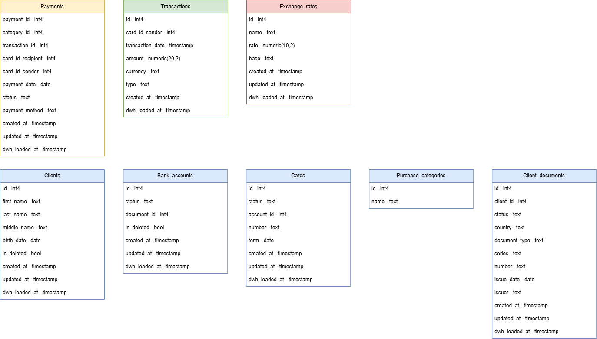
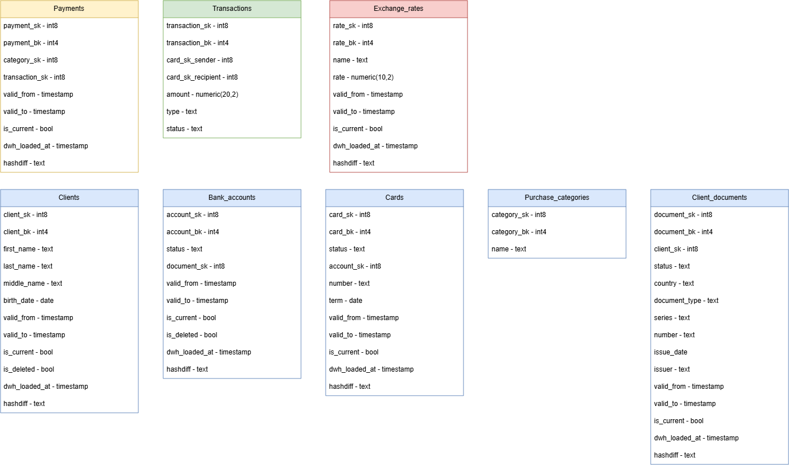
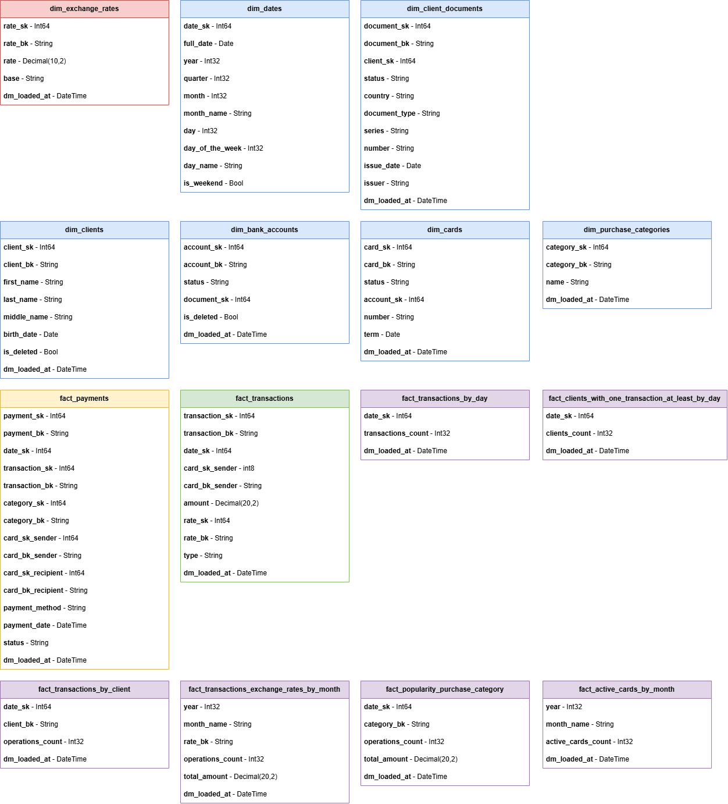

Ссылаясь на информацию, которую предоставляют источники, а также на бизнес-требования к системе, составим схемы таблиц, определив столбцы и их типы для слоев оперативных данных (ODS), SSOT (DDS) и витрин данных (DM).

	
	 
	Рис. 1. Схема данных для ODS.
	 

	
	 
	Рис. 2. Схема данных для DDS.
	 

	
	 
	Рис. 3. Схема данных для DM.
	 

