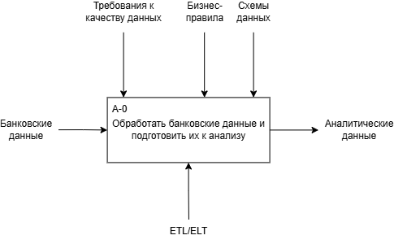
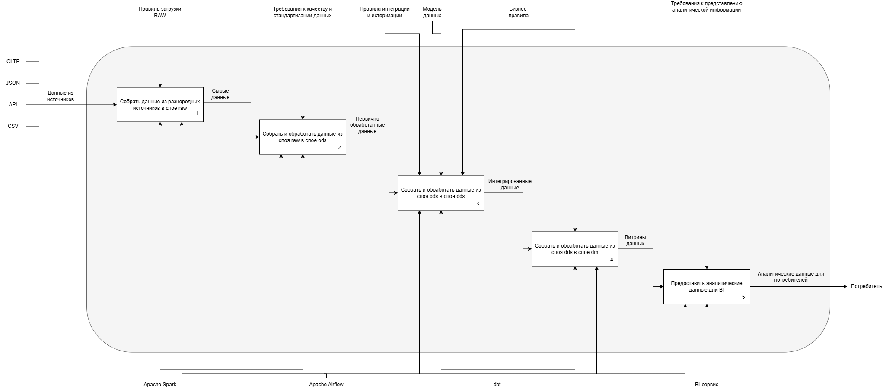
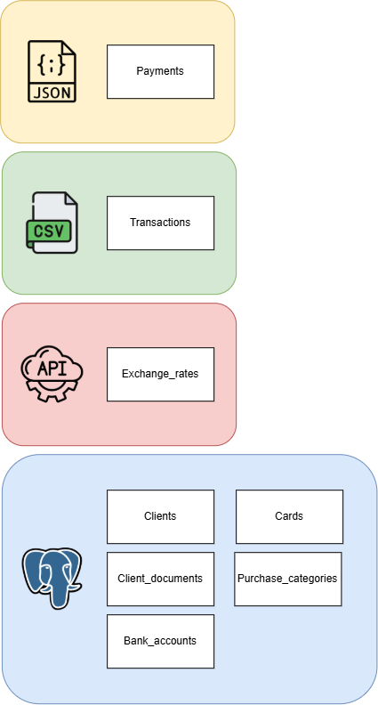

#1. Банковский домен.

##1.1 Предметная область.
	Прежде, чем переходить к проектированию банковского домена непосредственно, необходимо рассмотреть, какие задачи должна выполнять разрабатываемая система.
	Составим перечень **запросов аналитиков** к системе. Для текущей версии (V1) платформы спланированы следующие запросы:
* количество транзакций за день;
* количество клиентов, совершивших хотя бы 1 транзакцию за день;
* количество операций на каждого клиента;
* наиболее популярные категории покупок;
* количество активных карт за месяц;
* комиссионный доход за месяц;
* количество операций в каждой валюте за месяц.

	Чтобы корректно и удобно описать **бизнес-процессы**, воспользуемся *нотацией IDEF0*.

  

Рис. 1. Нотация IDEF0. Контекстная диаграмма.

Рис. 2. Нотация IDEF0. Декомпозиция первого уровня.

##1.2 Сущности и источники.
	Переходим к непосредственному проектированию банковского домена. Банковский домен в рассматриваемой системе для версии платформы V1 состоит из 7 следующих **сущностей**:
* клиенты;
* счета;
* карты;
* категории покупок;
* транзакции;
* платежи;
* курсы валют.

	Данные сущности приходят в хранилище из разнородных источников. Схематичное изображение **источников и сущностей** представлено ниже (см. рис. 3).

Рис. 3. Схема сущностей и источников.

	Теперь можно переходить к проектированию примерной архитектуры.
